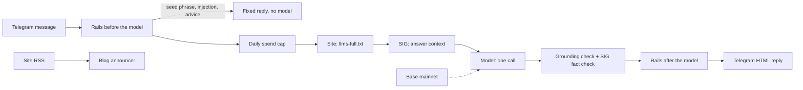

# Stoby, the AI helper of the Stobox community

A Telegram assistant for the Stobox Community group that answers questions about Stobox and the STBU token from live
sources, and posts every new blog article to the group. For community members and the Stobox team that runs it.


## Status

Production. Version 1.0.0 and 1.1.0 were released on 28 September 2026 (tags `v1.0.0`, `v1.1.0`). The current code is
`src/stoby`; `src/stobox_ai` is the previous bot, kept in the tree as the rollback. Checked 16 October 2026.

## What it is and why it exists

Stoby is `@stobox_assistant_bot`. It holds **no facts of its own**: every fact in an answer is read at answer time from the
live site reference file (`llms-full.txt` on stobox.io), the Stobox Intelligence Graph (SIG) and Base mainnet, so a change on
the site reaches the answers without a commit here. If any source is down, Stoby says it cannot check that right now and
makes no model call; it never answers from the model's memory.

| | |
|---|---|
| **Answers** | In a private chat, or in the group when it is mentioned by `@username`, called by name, or replied to. Short English with a few emojis, whatever language the question is in. |
| **Contracts and links** | Every contract or pool address is labelled and on its own line in monospace; official links sit under STBU answers. |
| **Visuals** | `/blog` shows the newest article's cover and the latest articles; answers that link to stobox.io carry a small preview card. |
| **Blog announcements** | Each new blog post goes once to the group's Announcements topic and to General Chat. |
| **Safety** | Warns about scams, never asks for or repeats a seed phrase, removes non-official links and unknown addresses from its own answers. |
| **Leads** | In a private chat an email plus a company question becomes a lead: one note to the admins, and a CRM webhook when configured. |

It does not moderate (a separate bot moderates the group), give investment advice, predict prices or post on a timer.

Commands: `/stbu`, `/check 0xAddress`, `/blog`, `/sources`, `/contact`, `/help`, `/start`. Their details are in
[documentation/ARCHITECTURE.md](documentation/ARCHITECTURE.md).

## Where it runs

A long-running worker on Railway, deployed from `main` (`railway.json`, `Dockerfile`), polling Telegram. It reads
`stobox.io/llms-full.txt`, the SIG MCP server and a Base RPC endpoint, and calls an Anthropic model (`claude-sonnet-5` by
default). State (spend ledger, last good copy of the site file, announcer record) lives on a mounted volume. Owner: the
repository owner, `genedeyev`.

## Architecture at a glance



The full pipeline, the code map and the failure modes are in [documentation/ARCHITECTURE.md](documentation/ARCHITECTURE.md).

## Repository layout

| Path | What it holds |
|---|---|
| `src/stoby/` | The current bot (version 1.1.0): pipeline, rails, Telegram layer, announcer, leads, ledger, `sources/` |
| `src/stobox_ai/` | The previous bot (stage 0), kept as the rollback |
| `config/` | The behaviour prompt `config/prompts/stoby.md` (tone and rules only) and the previous bot's configuration |
| `evals/` | Golden traps (31), the prompt-injection set (22) and the eval runners |
| `tests/` | Unit tests with offline fakes; `tests/stoby/` covers the current bot |
| `scripts/` | Stage 1 acceptance, Telegram identity setup and helper scripts |
| `deploy/` | Container entrypoint (drops root after fixing the volume owner) |
| `examples/` | A sample web widget page for the previous bot's web channel |
| `Procfile`, `render.yaml`, `docker-compose.yml`, `Makefile` | Run and deploy targets of the previous bot (`make run` starts `stobox_ai`) |
| `docs/` | Knowledge documents read by the previous bot; not documentation of this repository |
| `documentation/` | Architecture and operations of the current bot |
| `ARCHITECTURE.md`, `DEPLOY.md`, `SETUP.md`, `ROADMAP.md`, `SYSTEM-PROMPT.md`, `AUDIT-REPORT.md`, `VERIFICATION.md`, `SUBPROCESSORS.md` | Documents of the previous bot (July 2026), kept as written |

## Quick start

```bash
pip install -e ".[dev,web,crm]" httpx
python -m pytest -q                                   # unit tests, offline fakes
python -m stoby                                       # needs TELEGRAM_BOT_TOKEN and ANTHROPIC_API_KEY
```

The real-model eval run costs money (about $0.35 for 53 questions); run it once per release. Acceptance and eval commands
are in [documentation/OPERATIONS.md](documentation/OPERATIONS.md).

## Configuration

Names only; values go in `.env` (ignored by git) or the host's secret store.

| Variable | Needed | Meaning |
|---|---|---|
| `TELEGRAM_BOT_TOKEN` | yes | Bot token |
| `ANTHROPIC_API_KEY` | yes | Model key |
| `STOBY_SIG_TOKEN` | in production | SIG partner token |
| `TELEGRAM_ADMIN_USER_IDS` | yes | Numeric ids that receive lead notes |
| `STOBY_ANNOUNCE_CHATS` | for announcements | `chat` or `chat:topic`, comma list; empty means no posting |

The full list, with defaults, is in [documentation/OPERATIONS.md](documentation/OPERATIONS.md).

## Deploy and operate

Railway builds the `Dockerfile` from `main` and starts `python /entrypoint.py python -m stoby`. Rollback to the previous bot
is a one-line change of the start command in `railway.json`. Daily spend is capped by the code. Runbook:
[documentation/OPERATIONS.md](documentation/OPERATIONS.md).

## Versioning and releases

Semantic versioning. The version is in [VERSION](VERSION) and `src/stoby/__init__.py`; the history is in
[CHANGELOG.md](CHANGELOG.md); releases are annotated tags `vX.Y.Z` (latest: `v1.1.0`). TODO(owner): `pyproject.toml` still
says `0.1.0`; align it at the next release.

## Related

- `stobox-v15` (private): the website whose `llms-full.txt` and RSS feed are Stoby's sources.
- `stobox-sig` (private): the Stobox Intelligence Graph, the second source.
- The Stobox Community group on Telegram, `t.me/stobox_community`.
- Stobox vault page `Stoby` (private): the programme and acceptance criteria A1-1 to A1-7.

## Contributing

Branch from `main`, open a pull request, keep `ruff check src evals tests` and `pytest` green; CI also runs the offline eval
smoke, the golden compliance gate and a Docker build. Write commits and pull requests in English. Behaviour changes go in
the prompt file or the rails, never as facts in code: facts come from the sources. A release is a pull request that changes
`VERSION`, `__version__` and `CHANGELOG.md`.

## Security

No secrets in the repository: only variable names. The container refuses to run as root and drops root after fixing the
volume owner. Stoby never asks for or repeats a seed phrase and never calls the one SIG write tool. To report a
vulnerability, contact the maintainers privately at the contact address published on stobox.io; do not open a public issue.

## Licence

No licence is granted; all rights reserved. `pyproject.toml` declares the package as proprietary. TODO(owner): the choice of
a licence for this public repository is the owner's.
